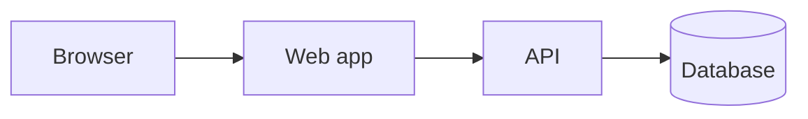

# Architecture

> Filled by `/init`, refined by `/plan`. Describe structure and boundaries, not every file.

## System overview

## Modules / bounded contexts
| Module | Responsibility | Depends on | Path |
|---|---|---|---|
| | | | |

## Layering rules
- UI → API client → routes → services → repositories → DB. No skipping layers.
- Shared types/schemas live in one place and are imported, never duplicated.
- Business logic lives in services, never in route handlers or components.

## Cross-cutting concerns
- **Auth & authorization:** 
- **Validation:** at every boundary using shared schemas
- **Error handling:** typed errors mapped to the API error format (see `api-contracts.md`)
- **Logging/observability:** structured logs, request IDs
- **Config:** env-based, validated at startup
- **Background jobs / queues:** 
- **Caching:** 

## Deployment topology
<!-- Environments, hosting, CI/CD, secrets management -->
Approved execution model: **local frontend development, cloud-hosted backend infrastructure.**
- Local workstation (MacBook): OpenCode/VS Code, repository, Git, frontend dev server, frontend
  lint/typecheck/build/test and browser tests against labelled mocks or approved cloud dev/staging endpoints.
- Cloud CI (GitHub Actions): repeats frontend checks on PRs; runs agent evals; dependency/security audits.
- Cloud backend environments (dev, staging, production): APIs/services, PostgreSQL and other databases,
  Redis/queues/workers, auth, object storage, email, payments/webhooks, scheduled jobs and durable execution,
  monitoring/backup/recovery. Separate environment configuration; server-only secrets never reach frontend code.
- Local development must never target production services/data without separate human authorization.

## Known constraints & tech debt
- 
