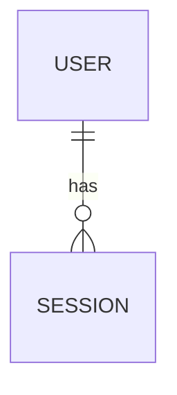

# Data Model

> Source of truth for persistent data. Update with every schema change, alongside the migration.

## Conventions
- Table names: `snake_case`, plural. Primary key: `id` (UUID v7 or bigint; see `decisions.md`).
- Every table: `created_at`, `updated_at`; soft delete (`deleted_at`) only when a spec requires it.
- Foreign keys always indexed. Money as integer minor units. Timestamps in UTC.
- Migrations are forward-only; never edit an applied migration.

## ER overview

## Entities

### user
| Column | Type | Null | Default | Notes |
|---|---|---|---|---|
| id | uuid | no | gen | PK |
| email | text | no | | unique, lowercased |
| created_at | timestamptz | no | now() | |

**Indexes:** `unique(email)`
**Introduced by:** feature `NNN-...`  **Migration:** `...`

<!-- Copy the block above per entity. -->

## Migration log
| Date | Migration | Feature | Summary |
|---|---|---|---|

## Data retention & privacy
- PII fields:
- Retention policy:
- Deletion/export behavior:
